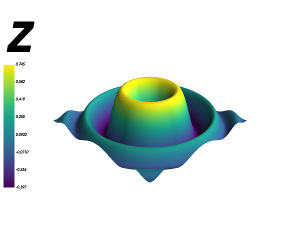
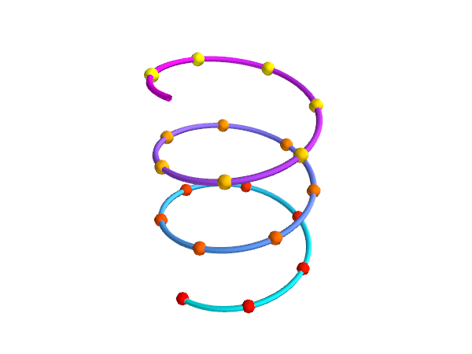

# Mayavi macOS test

A small smoke test that checks whether [Mayavi](https://docs.enthought.com/mayavi/mayavi/) installs and renders on a current Apple Silicon Mac, using nothing but `pip` in a plain virtual environment.

The result: it works, with one catch. Install **PyQt6, not PyQt5**. The [Mayavi install docs](https://docs.enthought.com/mayavi/mayavi/installation.html) say `pip install PyQt5`, and on this machine that makes Mayavi hang (details [below](#pyqt5-hangs-on-macos-26)).

## Tested environment

Everything below is what the notebook in this repo was actually run with, on 7 October 2026.

| Component | Version |
| --- | --- |
| macOS | 26.6.2 (build 25G83) |
| Hardware | Apple M1 Pro (arm64) |
| Python | 3.12.7 (Homebrew), in a `venv` |
| pip | 26.2.1 |
| Mayavi | 4.9.0 |
| VTK | 9.7.1 |
| PyQt6 | 6.11.0 (Qt 6.11.2) |
| NumPy | 2.5.3 |
| traits | 7.2.0 |
| traitsui | 8.0.0 |
| pyface | 8.0.0 |
| apptools | 5.3.1 |
| envisage | 8.0.1 |
| ipykernel | 7.4.0 |
| IPython | 9.17.1 |
| nbconvert | 7.17.1 |

Every package installed from a prebuilt wheel. Nothing was compiled.

## Setup

```sh
python3.12 -m venv .venv
source .venv/bin/activate
pip install -r requirements.txt
```

`requirements.txt` pins the packages the notebook uses directly; pip resolves the rest.

Then open `mayavi_smoke_test.ipynb` and select the `.venv` kernel, or run it from the command line:

```sh
jupyter nbconvert --to notebook --execute --inplace mayavi_smoke_test.ipynb
```

The four offscreen plots take a few seconds. The last cell then opens an interactive window and waits until you close it.

## What the notebook tests

The first four scenes are rendered offscreen, saved as PNGs, and displayed inline, so they work in any Jupyter frontend.

| `mlab.surf` | `mlab.mesh` |
| --- | --- |
|  |  |

| `mlab.plot3d` + `mlab.points3d` | `mlab.contour3d` |
| --- | --- |
|  |  |

The fifth and last cell opens a native interactive Qt window (`mlab.test_plot3d()` followed by `mlab.show()`) that you can rotate and zoom. The cell blocks until you close the window. It needs a display, so skip it on a headless machine.

## PyQt5 hangs on macOS 26

With PyQt5 5.15.11 installed instead of PyQt6, `mlab.figure()` never returns. The process sits at 0% CPU, even with `mlab.options.offscreen = True`.

A native stack sample of the stuck process shows Qt 5's macOS platform plugin entering `[NSApplication run]` from `QCoreApplication.processEvents` and never coming back. A bare PyQt5 application without VTK processes events normally, so the hang needs both VTK and Qt 5 in the same process.

Replacing PyQt5 with PyQt6 fixes it. Mayavi picks PyQt6 up automatically when PyQt5 is not installed, so no environment variables are needed. If you have both installed, uninstall PyQt5.

## Other install routes

Only the pip route above is verified here. A conda-forge environment (`mamba create ... mayavi pyqt`) was tried first and abandoned. It was not investigated in detail, but the `pyqt` package it resolves to is 5.15, the same Qt 5 line that hangs with pip.

## How this was made

This project was put together with [Claude Code](https://claude.com/claude-code).
