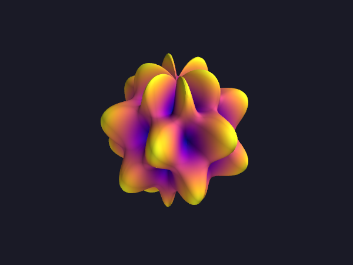
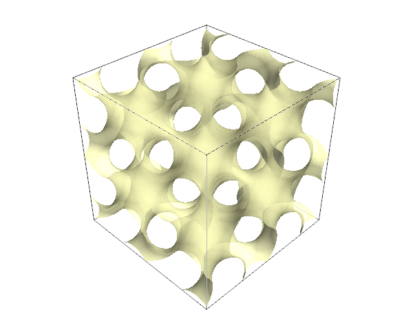

# Mayavi macOS test

Checks whether [Mayavi](https://docs.enthought.com/mayavi/mayavi/) installs and renders on an Apple Silicon Mac with plain `pip`, and whether it can render interactively inside a Jupyter notebook.

**Result:** both work, with two catches:

- Install **PyQt6, not PyQt5**. PyQt5 makes Mayavi hang on macOS 26 (see [below](#pyqt5-hangs-on-macos-26)).
- Mayavi's in-notebook viewer is broken with current packages. The notebooks in `notebook-viewer/` patch it.

Tested on macOS 26.6.2, Apple M1 Pro, Python 3.12.7, Mayavi 4.9.0, VTK 9.7.1, PyQt6 6.11.0 and NumPy 2.5.3. All other versions are pinned in `requirements.txt`.

## Setup

```sh
python3.12 -m venv .venv
source .venv/bin/activate
pip install -r requirements.txt
```

Open the notebooks in VS Code with the `.venv` kernel, or in a browser with `jupyter lab`.

## Smoke test

[`smoke-test/mayavi_smoke_test.ipynb`](smoke-test/mayavi_smoke_test.ipynb) renders four scenes offscreen and shows them inline:

| `mlab.surf` | `mlab.mesh` |
| --- | --- |
|  |  |

| `mlab.plot3d` + `mlab.points3d` | `mlab.contour3d` |
| --- | --- |
|  |  |

The last cell opens a native Qt window you can rotate and zoom. It blocks until you close the window.

## Notebook viewer

Both notebooks render a surface under the code cell, as a static image and as an interactive viewer (drag to rotate, scroll to zoom). A last cell checks that dragging works.

- [`viewer_local.ipynb`](notebook-viewer/viewer_local.ipynb): for a kernel on your own machine (VS Code, or Jupyter in a browser on localhost).
- [`viewer_hosted.ipynb`](notebook-viewer/viewer_hosted.ipynb): for uploading to a hosted Jupyter. It installs its own packages and sets up rendering on a Linux server.

Run all cells from a fresh kernel.

| Where | Result |
| --- | --- |
| JupyterLab in a browser (local) | Works |
| VS Code | Works, but the first viewer of a session may not appear. Re-run the cell. |
| Google Colab | Renders, but too slow to interact with |
| jupyter.org/try | Can't work: it runs Python in the browser, and Mayavi's 3D engine (VTK) can't run there |

Zooming is coarse: Mayavi zooms in fixed steps.

The notebooks patch four bugs in Mayavi 4.9.0's viewer: a crash with NumPy 2, the view snapping back after you release the mouse, errors on keys like Shift, and the last frame of a drag being dropped. `requirements.txt` also pins puremagic 1.30, because Mayavi uses a function that puremagic 2 removed.

## PyQt5 hangs on macOS 26

With PyQt5 instead of PyQt6, `mlab.figure()` never returns, even offscreen. Qt 5 and VTK together hang in macOS's event loop. Installing PyQt6 instead fixes it, with no extra configuration.

A conda-forge environment was also tried and abandoned. It installs PyQt 5.15, the version that hangs.

## How this was made

This project was put together with [Claude Code](https://claude.com/claude-code).
